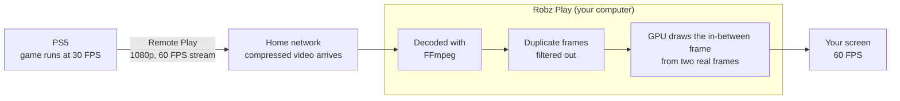

<p align="center">
  
</p>

<p align="center">
  <a href="https://github.com/kutsalkiremitci/robz-play/releases/latest"></a>
  <a href="https://github.com/kutsalkiremitci/robz-play/releases"></a>
  <a href="https://github.com/kutsalkiremitci/robz-play/stargazers"></a>
  <a href="COPYING"></a>
  <br>
  
  
  
  
  
</p>

<p align="center">
  <a href="#step-by-step-setup"></a>
  <a href="#how-it-works"></a>
  <a href="#faq-and-troubleshooting"></a>
</p>

#  Robz Play

**Robz Play is built for GTA VI: it lets you play games that run at 30 FPS on PS5 with 1080p and 60 FPS smoothness on your computer screen.** It connects to your PS5 over your home network via Remote Play, while your computer's GPU generates the in-between frames. No capture card required: a PS5, a computer, and the network they share are all you need.

- **1080p · 60 FPS:** PS5 Remote Play stream. Play your console from your computer; the image is what your console sends.
- **30 → 60 FPS:** your GPU generates the in-between frames. A 120 FPS option is experimental.
- **No capture card:** PS5, computer, and home network are enough.
- **English & Turkish:** full UI support for both languages.

Frame generation is optional: you can toggle it on or off with one click from the **Display mode** section in the middle of the home screen. GTA VI runs at 30 FPS on consoles; frame generation was written for this reason and developed while playing GTA VI. The same approach works in all PS5 and PS4 games locked to 30 FPS.

<p align="center">
  <a href="https://github.com/kutsalkiremitci/robz-play/releases/latest/download/RobzPlay-Setup.exe"></a>
  <a href="https://discord.gg/UyyEn7SHm4"></a>
  <a href="https://kick.com/robzsogood"></a>
</p>
<p align="center">
  <sub>The download link always points to the latest release. Previous versions and changelogs: <a href="https://github.com/kutsalkiremitci/robz-play/releases">GitHub releases</a>.</sub>
</p>

<p align="center">
  
</p>
<p align="center">
  <sub>GTA VI with Robz Play. The top-left counter shows the displayed frame rate (60 FPS) and the source coming from the console (~30).</sub>
</p>

## See the difference: 30 FPS vs 60 FPS side by side

Same GTA VI footage: on the left, the image reduced to 30 FPS; on the right, Robz Play outputting 60 FPS. The difference is immediately noticeable when panning the camera and driving.

<p align="center">
  
</p>
<p align="center">
  <sub>The left side is simulated: the same recording reduced to 30 FPS. Captured with OBS from the Robz Play window; the animation plays at real 60 FPS speed.</sub>
</p>

GIF version of the comparison: [`assets/robzplay/gta-vi-30-vs-60.gif`](assets/robzplay/gta-vi-30-vs-60.gif). Because the GIF format supports at most 50 FPS, that file plays at 83% speed; the animation above plays at true 60 FPS speed.

### PS Remote Play vs Robz Play

| | PS Remote Play<br><sub>Set to 720p · 30 FPS</sub> | Robz Play |
|---|:---:|:---:|
| **Frame rate you see in GTA VI** | 30 FPS | **60 FPS** |
| **Resolution** | 720p | **1080p** |
| **Frame generation** | No | **Yes**, on the GPU |
| **Source code** | Closed | **Open** (AGPL-3.0) |

> [!NOTE]
> To be fair: the official PS Remote Play app can also be set to 1080p and 60 FPS stream output. However, it does not generate frames; because GTA VI runs at 30 FPS, the motion you see on screen is still 30 FPS. What makes the difference is Robz Play generating the in-between frames.

## Before you start: what do you need?

No extra hardware. Your console, your computer, and the home network they share are enough.

| | |
|---|---|
| **PlayStation 5** | PS4 also works. Remote Play must be enabled on the console (shown in [step 4](#4-prepare-your-ps5)). |
| **Windows 10 or 11** *(macOS Apple Silicon also supported from source)* | 64-bit computer. 60 Hz display for 60 FPS, or 120 Hz+ display for 120 FPS. |
| **Dedicated Vulkan GPU (or Apple Silicon Metal)** | NVIDIA GTX/RTX, AMD Radeon RX, Intel Arc, or Apple Silicon (native Metal + MPSGraph). Frame generation runs on the GPU; it is not DLSS and is not NVIDIA-only. |
| **Same home network** | PS5 and computer must be on the same network. Connecting both to your router via Ethernet gives the most stable picture. |
| **PlayStation account** | One-time PSN sign-in when pairing your console. Not needed if your console is already linked in chiaki-ng. |

**Not required:** capture card, HDMI splitter, or a second device. On Windows/Linux, integrated CPU graphics (Intel UHD / AMD integrated) are not fast enough: a single frame takes seconds.

### Is your GPU fast enough?

Your GPU needs to generate an intermediate frame in under ~10 milliseconds (or within half the 30 FPS cadence on Apple Silicon).

| GPU | Expectation | Status |
|---|---|---|
| Integrated graphics (Intel UHD, AMD Radeon Graphics) | Won't keep up: one frame takes seconds | Measured (AMD integrated: ~2.7 s/frame) |
| Entry-level dedicated GPU (GTX 1650 class) | 60 FPS may be possible in "Fast" motion detail mode | Estimated, untested |
| Mid-range GPU (RTX 3060, RX 6600 XT class and above) | 60 FPS in "Balanced" mode | Estimated, untested |
| RTX 4070 | 60 FPS "Balanced": ~5–10 ms per frame. 120 FPS works experimentally | Measured |
| Apple Silicon (M1) | 60 FPS via native Metal + MPSGraph (`Auto` / `divisor=3`: ~19.7 ms median) | Measured |

So far on Windows it has **only been tested on an RTX 4070**, and on macOS on an **Apple M1**; the other rows are estimates and will be updated as more GPUs are tested. If your GPU struggles, set **Motion detail** to "Fast": motion is estimated at quarter resolution and GPU load drops significantly.

## Step-by-step setup

From download to your first game. The first four steps are preparation, the rest happen inside the app. Screenshots are from Robz Play 0.4.0; the console address and ID were hidden using "streamer mode".

### Preparation

#### 1. Download the installer

<a href="https://github.com/kutsalkiremitci/robz-play/releases/latest/download/RobzPlay-Setup.exe"></a>

`RobzPlay-Setup.exe` is always the latest release. It is free and requires no account or registration to download. Each release's changelog and SHA-256 checksum are listed on the [releases page](https://github.com/kutsalkiremitci/robz-play/releases).

#### 2. Bypass the Windows warning

Because the installer is not code-signed yet, Windows may show **"Windows protected your PC"** on first launch. Click **More info**, then **Run anyway**.

#### 3. Install and launch

Complete the setup; no administrator rights required. Robz Play installs into `%LOCALAPPDATA%\Programs\Robz Play`. Launch it from the **Robz Play** shortcut on your Desktop or Start Menu.

#### 4. Prepare your PS5

Order matters: users first, then Remote Play.

**1) Add a second, empty user.** On your PS5, open the profile icon in the top right of the home screen (or press the PS button to open Control Center), choose **Switch User**, then **Add User**; a blank local profile is enough. If the console only has one user, clicking **Play** can cause the PS5 to wake, auto-select that user, and kick Remote Play back to the main menu. With two users, the PS5 asks who is playing after connecting: pick the **second (side) profile instead of your main profile** to continue. If a controller (DualSense) is connected to your PC, you can also continue with your main profile.

**2) Remove your login passcode.** If your profile has a PS5 login passcode (4-digit PIN), remove it; it can cause connection issues.

**3) Enable Remote Play on each profile:**

> **Settings › System › Remote Play › Enable Remote Play**

If you also want to connect while the console is in Rest Mode, enable both options here:

> **Settings › System › Power Saving › Features Available in Rest Mode**

### Inside Robz Play

#### 5. First launch: your console appears automatically

You can switch the interface language anytime using the flags in the left sidebar. If your PS5 and computer are on the same network, your console appears automatically at the top of the home screen. In the center sits the **Display mode** section where you choose how the game is presented.

<p align="center">
  
</p>
<p align="center">
  <sub>Home screen. The console card shows "Address hidden" and "ID hidden": streamer mode was active when captured.</sub>
</p>

> [!TIP]
> **Already using chiaki-ng?** On first launch, Robz Play automatically imports your chiaki-ng settings and saved consoles; if your console is already paired, skip step 6. Regardless of your chiaki-ng settings, frame generation, 60 FPS, and Vulkan are enabled by default. Your chiaki-ng settings remain untouched.

#### 6. Pair your console (once)

Click **Setup** on your console's card.

<p align="center">
  
</p>

The **Register console** wizard walks through four steps. Each step explains what it does and what to do on the console on the right; **Back** and **Next** buttons sit at the bottom.

1. **Console:** PS5 comes pre-selected with its network address detected. Click **Next**.
2. **Account:** two options. If you've signed in before, it shows "Account ready" and skips this step.
   - **1 · Sign in via browser** (recommended, always works): click **Open sign-in page** and log in with the account you use on the console. After signing in, the browser opens a blank or error-like page; this is normal. Click the address bar, press **Ctrl+A** and **Ctrl+C**, and return to Robz Play: the URL is picked up automatically (or paste it into the box). The code in the URL stays valid for a few minutes.
   - **2 · Find by online ID** (no sign-in needed): enter your PSN username and click **Find**. For it to find you, set everything under **Settings › Users and Accounts › Privacy** on your PS5 to **Anyone**. This lookup isn't hosted by Sony: it can occasionally fail on the first try and succeed after a couple of attempts.
3. **Pairing code:** on your PS5, go to **Settings › System › Remote Play › Link Device** and enter the 8-digit code shown on screen. Get the code while signed into the same profile (your main profile) you used in step 2: a code generated on the second, blank profile will return an "Invalid PSN ID" error.
4. **Save:** check the summary and click **Register console**. Once "Console registered" appears, click **Done**.

<p align="center">
  
  
</p>
<p align="center">
  <sub>Left: step 2 (PlayStation account, two methods). Right: step 3 (PS5 pairing code). Captured with streamer mode enabled.</sub>
</p>

#### 7. Choose your display mode

Select **60 FPS** for GTA VI; this is the default mode. Pick **Stream only** if you don't want frame generation, or experimental **120 FPS** if you have a fast GPU and a 120 Hz+ display. Mode changes take effect on the next connection. Below it, you can also adjust **Motion detail**, **Keep HUD & text steady**, **Sharpening**, and **FPS counter**.

<p align="center">
  
</p>

#### 8. Play

Once registered, a **Play** button appears on your console card. Clicking it connects Robz Play to your PS5; if Rest Mode options from step 4 are enabled, a sleeping console is woken up too. Once connected, the game stream appears.

<p align="center">
  
</p>
<p align="center">
  <sub>Screen shown while connecting.</sub>
</p>

#### 9. In-game: stream menu

Press `Ctrl + O` to open the stream menu: volume, microphone, zoom, sharpening, FPS counter, and renderer settings can all be changed without leaving the game.

<p align="center">
  
</p>
<p align="center">
  <sub>The stream menu opens at the bottom of the screen.</sub>
</p>

#### 10. Settings

**Settings** in the left sidebar covers frame generation, video, streaming, audio, consoles, keyboard, and controller mappings. Values in parentheses are defaults. On the **Stream** page, resolution, FPS, bitrate, and codec can be configured separately for home (Local) and away-from-home (Remote) connections.

<p align="center">
  
</p>
<p align="center">
  <sub>General: frame generation and basic settings.</sub>
</p>

<p align="center">
  
</p>
<p align="center">
  <sub>Stream: 1080p, 60 FPS, 100 Mbps, H265.</sub>
</p>

### Updating and uninstalling

- **To update**, you don't need to do anything. When a new version is out, Robz Play shows the changelog in a **What's new** window; **Update now** downloads, installs, and relaunches the app. The app checks on startup and every few hours; if you don't want to wait, click **Check for updates** below the version number in the bottom left. If up to date, it says "Robz Play is up to date". You can also download and run the latest `RobzPlay-Setup.exe` manually. Your settings and paired consoles are preserved either way.
- **To uninstall**, remove Robz Play from Windows "Installed apps". Your settings remain in the Windows registry.

<details>
<summary><b>Building from source</b> (for developers)</summary>

1. Install [MSYS2](https://www.msys2.org/) at its default location (`C:\msys64`) and open the **MSYS2 MINGW64** shell.
2. Clone the repository with its submodules:

   ```bash
   git clone -c core.autocrlf=false --recursive https://github.com/nykadamec/robz-play.git
   cd robz-play
   ```

3. Install dependencies once (takes a while), then build:

   ```bash
   ./scripts/robzplay-setup-msys2.sh
   ./scripts/robzplay-build.sh
   ```

4. Double-click **`start.bat`** in the repository root. The app launches from `dist\RobzPlay`.

To produce the release installer (`RobzPlay-Setup.exe`) and portable zip package: `./scripts/robzplay-package.sh`.

</details>

## Three display modes

Centered on the home screen. Frame generation is optional: toggle it on, off, or change its target in one click.

| Mode | What it does | Seen in 30 FPS GTA VI |
|---|---|:---:|
| **Stream only** | Plain Remote Play: 1080p, 60 FPS stream, as sent by the console. Frame generation off, no extra latency. | 30 FPS |
| **60 FPS** `For GTA VI` | Your PC's GPU draws the in-between frames; a 30 FPS game looks like 60 FPS. Default and recommended mode. | **60 FPS** |
| **120 FPS** `Experimental` | Generates three frames between every two real frames. Requires a fast GPU and a 120 Hz+ display. | 120 FPS |

**Good to know**

- Mode changes take effect on the next connection.
- In a game that already runs at 60 FPS, "Stream only" and "60 FPS" look the same; the difference shows in games locked to 30 FPS.
- Sharpening and the FPS counter apply immediately; frame generation settings take effect on the next stream.

### Why is 120 FPS experimental?

- Requires substantially more GPU power than 60 FPS mode.
- Because three out of four frames are generated, artifacts are more noticeable during fast motion.
- Only tested on a single system (RTX 4070). If you hit issues, switch back to 60 FPS; it is the recommended mode for daily play.

## Settings

### Default settings

Robz Play was developed and tested with these defaults:

| Renderer | Codec | Resolution | Stream | Bitrate | Audio |
|:---:|:---:|:---:|:---:|:---:|:---:|
| **Vulkan** | **H265** | **1080p** | **60 FPS** | **100 Mbps** | **100%** |

| Motion detail | Sharpening | FPS counter |
|:---:|:---:|:---:|
| **High** | **High** | **On** |

**High** motion detail is roughly three times heavier on the GPU than **Balanced**; if your GPU struggles, switch to Balanced or Fast in **Settings › General**.

Vulkan is selected as the default renderer because the developer's companion app Robz Vision (which reads subtitles from screen) cannot capture OpenGL frames. When connecting away from home, 100 Mbps exceeds most residential upload speeds; lower the bitrate in the **Remote** column on the **Settings › Stream** page.

### Frame generation settings

| Setting | Options | What it does |
|---|---|---|
| Display mode | Stream only / 60 FPS / 120 FPS `Experimental` | Turns frame generation off or sets its target. Located in the center of the home screen. |
| Motion detail | Fast / Balanced / High / Auto | Resolution at which motion is estimated. High is cleaner, but roughly three times heavier on the GPU. |
| Keep HUD & text steady | On / Off | Preserves static UI elements in generated frames. |
| Sharpening | Off / Low / Medium / High | Restores crispness to the compressed stream; applies immediately. |
| FPS counter | On / Off | Displayed and source FPS in the top-left corner. |

## Highlights

| | |
|---|---|
| **1080p, 60 FPS Remote Play** | Connect to your PS5 over your home network and play from your computer. Also works without frame generation. |
| **30 → 60 FPS** | GTA VI and other 30 FPS-locked PS5 and PS4 games at 60 FPS smoothness. |
| **120 FPS** `Experimental` | Generates three frames between every two real frames; see [above](#why-is-120-fps-experimental) for details. |
| **HUD & text protection** | Static elements like health bars, minimap, and subtitles stay locked in place without shimmering. |
| **Sharpening** | Restores detail lost to stream compression; changes live mid-game. |
| **OBS-visible FPS counter** | Shows both displayed and source FPS. Drawn inside the frame so it also appears in recordings. |
| **In-stream menu** | `Ctrl + O`: audio, microphone, zoom, sharpening, FPS counter. |
| **English & Turkish** | Switch languages anytime using the flags in the left sidebar. |
| **Update notifications** | When a new release is out, "What's new" shows the changelog in your language; "Update now" downloads, installs, and relaunches. You can also check anytime via "Check for updates". |
| **Discord support** | One-click access to free setup support via the Discord button in the left sidebar. |
| **Startup log** | Every launch writes a log file so issues are easy to trace. |
| **Seamless chiaki-ng migration** | Imports your chiaki-ng settings and paired consoles on first launch without touching chiaki-ng's own config. |
| **Full Remote Play feature set** | Based on [chiaki-ng](https://github.com/chiaki-ng/chiaki-ng): DualSense support, PSN remote connection away from home, key mapping, profiles. |

## How it works

The PS5 still runs the game at 30 FPS. What becomes smooth is the picture displayed on your screen.



1. **PS5:** the game runs at 30 FPS. Video is sent over Remote Play as a 1080p, 60 FPS stream; each frame arrives twice.
2. **Home network:** the compressed stream reaches your computer and is decoded with FFmpeg.
3. **Robz Play:** duplicate frames are filtered out; your GPU draws the in-between frame between two real frames.
4. **Your screen:** 30 real + 30 generated frames per second, evenly paced. Result: 60 FPS.

### Where does the in-between frame come from?

- Robz Play filters out stream duplicates to find the game's true 30 frames per second.
- A neural model running on the GPU, **RIFE v4.6**, estimates motion between consecutive real frames and synthesizes the exact midpoint frame. On Windows/Linux it runs on [ncnn](https://github.com/Tencent/ncnn) and Vulkan across NVIDIA, AMD, and Intel GPUs; on macOS Apple Silicon it runs natively via **Apple Metal + MPSGraph**.
- **Static HUD elements** such as health bars, minimaps, and subtitles are explicitly protected so they don't shimmer against a moving background.
- If the GPU cannot finish a frame in time, Robz Play skips generating that frame; the stream never freezes.

### What it does and what it doesn't

**What it does**

- Camera pans, driving, and motion in 30 FPS-locked games like GTA VI become visibly smoother.
- Requires no extra hardware. No capture card, HDMI splitter, or second device.
- Free and open source; everything it does is readable in the code.

**What it doesn't**

- **Does not speed up the PS5.** The game still runs at 30 FPS on the console; what becomes smooth is the image you see.
- **Does not reduce latency; adds a little.** On top of Remote Play's latency, it waits for the next real frame to draw the in-between frame (~33 ms at 30 FPS). Comfortable for single-player games; not suited for competitive multiplayer.
- **Not HDMI quality.** Video arrives compressed over the network, so it isn't as sharp as a PS5 plugged directly into a TV. Sharpening reduces the difference, not all of it.
- **Not flawless.** Artifacts can appear in generated frames during very fast motion or fine patterns.
- **Not an official product.** Not affiliated with or endorsed by Sony Interactive Entertainment, PlayStation, Rockstar Games, or Take-Two.

## Built with

Robz Play stands on the shoulders of open source. Thank you to the developers of these projects.

| Project | Role in Robz Play |
|---|---|
| [chiaki-ng](https://github.com/chiaki-ng/chiaki-ng) and Florian Märkl's [Chiaki](https://git.sr.ht/~thestr4ng3r/chiaki) before it | Complete Remote Play protocol and session handling |
| [Qt 6 / QML](https://www.qt.io/) | User interface |
| [libplacebo](https://code.videolan.org/videolan/libplacebo) + Vulkan | Video processing and rendering |
| [FFmpeg](https://ffmpeg.org/) | Stream decoding |
| [RIFE](https://github.com/hzwer/Practical-RIFE) v4.6 (hzwer), [rife-ncnn-vulkan](https://github.com/nihui/rife-ncnn-vulkan) (nihui), and [ncnn](https://github.com/Tencent/ncnn) | GPU frame generation |
| [NSIS](https://nsis.sourceforge.io/) | Windows installer |
| [MSYS2](https://www.msys2.org/) / MinGW | Windows builds |

## FAQ and troubleshooting

If you don't find your answer here, ask in our Discord server; setup support is free. The **Discord support** button in the app's left sidebar also takes you there.

<a href="https://discord.gg/UyyEn7SHm4"></a>

### Installation and startup

<details>
<summary><b>Windows says "Windows protected your PC"</b></summary>

Because the installer is not code-signed yet, Windows may show this warning. Click **More info**, then **Run anyway**. Code signing is on the roadmap.

</details>

<details>
<summary><b>Robz Play won't open or shows an error</b></summary>

Install the latest version first: startup issues on Windows usernames with non-ASCII characters (like Turkish letters) were fixed in 0.3.0. If it still fails, check the logs and generate a diagnostic file (below).

</details>

<details>
<summary><b>Where are the logs?</b></summary>

The **"Robz Play logs"** Start Menu shortcut opens the log folder: `%APPDATA%\RobzPlay\RobzPlay\log`

- `robzplay-acilis.log`: written on every launch; the previous launch is kept as `robzplay-acilis-onceki.log`. If the app crashes, the last line shows which file it crashed in.
- `chiaki_session_….log`: per-session stream log.

</details>

<details>
<summary><b>Which file should I send when asking for support?</b></summary>

Double-click **`Tani.bat`** in the installation folder (`%LOCALAPPDATA%\Programs\Robz Play`). It writes system, GPU, and recent launch info to `robzplay-tani.txt` on your Desktop. Attach this file when describing your issue on Discord.

</details>

<details>
<summary><b>I already use chiaki-ng — do I have to set everything up again?</b></summary>

No. On first launch, Robz Play automatically imports your chiaki-ng settings and paired consoles; no re-pairing needed. chiaki-ng's own settings are left untouched.

</details>

<details>
<summary><b>How do I update or uninstall?</b></summary>

See the [Updating and uninstalling](#updating-and-uninstalling) section above.

</details>

### Connection and video

<details>
<summary><b>The controller disconnects when clicking "Play"</b></summary>

If the stream opens but DualSense doesn't work in-game or disconnects, the cause is having only one user profile on the PS5. Robz Play uses the same Remote Play connection as chiaki-ng, which requires a second user profile on the console for the remote controller. This comes from Remote Play (and chiaki-ng) behavior, not frame generation.

Fix:

1. Add a second user profile on your PS5: open the profile icon at the top right of the home screen (or press the PS button to open Control Center), choose **Switch User**, then **Add User**.
2. Remove any login passcode from your profile; it can cause connection issues.
3. Click **Play** again in Robz Play. The PS5 will show a profile selection screen with both profiles.
4. Select the **second (side) profile** and continue; the controller will work. If a DualSense controller is plugged into your PC, you can also continue with your main profile.

**Important for GTA VI:** to play a game owned by your main account using the second profile, **Console Sharing and Offline Play** must be enabled for that PS5 on your main account: **Settings › Users and Accounts › Other › Console Sharing and Offline Play**. This is usually already enabled on the first account set up on the console.

Menu names may vary slightly depending on PS5 firmware version. If it still disconnects after these steps, ask on Discord and attach `robzplay-tani.txt`.

</details>

<details>
<summary><b>My console doesn't appear on the home screen</b></summary>

Make sure Remote Play is enabled on your PS5 (**Settings › System › Remote Play**) and that your PS5 and computer are on the same network. The **Search for consoles** toggle on the left of the home screen should be enabled. If the console is in Rest Mode, both options under **Settings › System › Power Saving › Features Available in Rest Mode** must be enabled.

</details>

<details>
<summary><b>The image stutters or breaks up</b></summary>

Connect both your PS5 and your computer to your router via Ethernet. Wired connections give the most stable stream; Wi-Fi stutters more often.

</details>

<details>
<summary><b>My GPU is struggling</b></summary>

Set **Motion detail** on the home screen to "Fast". Motion is measured at quarter resolution, cutting GPU load significantly. Whenever frame generation cannot keep up, Robz Play automatically skips generating that frame so the video never freezes. If you're using 120 FPS, switch back to 60 FPS.

Integrated CPU graphics on Windows/Linux aren't fast enough for frame generation; a dedicated Vulkan-capable GPU is required (on macOS, Apple Silicon uses native Metal + MPSGraph). Select "Stream only" mode to play without frame generation.

</details>

<details>
<summary><b>I see artifacts in generated frames</b></summary>

Because motion is estimated from video frames, very fast camera movement or fine patterns can produce artifacts in generated frames. This is more noticeable in 120 FPS mode because three out of four frames are generated. Keep **Keep HUD & text steady** enabled. If your GPU has headroom, setting **Motion detail** to "High" yields cleaner motion, at roughly three times the GPU cost.

</details>

<details>
<summary><b>Is there extra latency? Can I use it for competitive games?</b></summary>

Frame generation adds some latency: it waits for the next real frame to draw the midpoint frame (~33 ms at 30 FPS) on top of Remote Play's own latency. It feels great for single-player games, but is not suitable for competitive multiplayer. Pick "Stream only" mode when lowest latency matters.

</details>

<details>
<summary><b>Can I connect away from home?</b></summary>

Yes, Remote Play supports connecting away from home with your PSN account (**Settings › Remote Play › Sign in to PSN**). However, the default 100 Mbps is too high for most residential internet upload speeds: lower the bitrate in the **Remote** column on the **Settings › Stream** page. Poor connections degrade image quality and latency.

</details>

### General

<details>
<summary><b>Do I need a capture card?</b></summary>

No. Video arrives from your PS5 over the network via Remote Play.

</details>

<details>
<summary><b>Is this DLSS? My GPU isn't NVIDIA.</b></summary>

No, it is not DLSS and does not use NVIDIA- or AMD-proprietary technology. Frame generation uses the open-source RIFE v4.6 model on ncnn + Vulkan (and native Metal + MPSGraph on Apple Silicon), so it works on NVIDIA GTX/RTX, AMD Radeon RX, Intel Arc, and Apple Silicon GPUs.

DLSS runs inside the game engine using engine motion vectors. Because GTA VI runs on the PS5 and only video reaches your computer, Robz Play estimates motion directly from the incoming frames — which is why it works on any GPU and any game over Remote Play.

</details>

<details>
<summary><b>Which games does it work with?</b></summary>

Built for GTA VI and developed while playing GTA VI, it works with any PS5 or PS4 game that supports Remote Play. The biggest difference is in 30 FPS-locked games; a game already running at 60 FPS gains nothing from 60 FPS mode.

</details>

<details>
<summary><b>Can I stream or record with OBS?</b></summary>

Yes. Add the Robz Play window as a Game/Window Capture source; generated frames and the FPS counter are included in the recording.

</details>

<details>
<summary><b>Is HDR supported?</b></summary>

Frame generation with HDR streams has not been tested yet.

</details>

<details>
<summary><b>Is it paid? Is it an official app?</b></summary>

It is free and open source (AGPL-3.0). It is not an official product: it has no affiliation with and is not endorsed by Sony Interactive Entertainment, Rockstar Games, or Take-Two Interactive.

</details>

## Roadmap

- Code-signed Windows installer.
- Automatic GPU benchmark on first launch to pick optimal defaults.
- Reducing added frame-generation latency.
- Quality tuning with real game footage and testing on more GPUs.

## For developers

- The frame generation core lives in `robzfg/`: RIFE v4.6 running on [ncnn](https://github.com/Tencent/ncnn) + Vulkan (and Apple Metal + `MPSGraph` on macOS). Use `robzfg-lab` to benchmark speed and PSNR quality.
- The UI is Qt 6 / QML (`gui/src/qml`). Translations live in `gui/res/i18n/tr.json`; `python gui/tools/i18n_extract.py` lists missing strings.
- Use `ROBZPLAY_UI_PREVIEW` (`stream-loading`, `stream-menu`, `home-empty`) to inspect UI states without a console, and `ROBZPLAY_SETTINGS_ORG` to test without touching your own settings.
- Test frame generation on your PC without a PS5: `ROBZPLAY_FRAMEGEN_SELFTEST=1`.
- Test update checking: `ROBZPLAY_UPDATE_URL` points to an alternate feed, and `ROBZPLAY_VERSION_OVERRIDE` overrides the reported app version. Release notes are split by language using `<!-- robzplay:tr -->`, `<!-- robzplay:en -->`, and `<!-- robzplay:end -->`.

## License

**Robz Play is a modified version of [chiaki-ng](https://github.com/chiaki-ng/chiaki-ng) 1.10.1.** Modifications began on November 20, 2026 and are fully visible in this repository's commit history (last upstream chiaki-ng commit: `43728af2`). Robz Play is not created or endorsed by the chiaki-ng or Chiaki developers; please report Robz Play issues to [this repository](https://github.com/nykadamec/robz-play/issues), not upstream.

Like chiaki-ng, Robz Play is licensed under **AGPL-3.0-only** (with OpenSSL exception); full text is in [`LICENSES`](LICENSES) and [`COPYING`](COPYING). The RIFE model and `rife-ncnn-vulkan` code are MIT-licensed; their license texts are in their respective directories.

PlayStation, PS5, PS4, and DualSense are trademarks of Sony Interactive Entertainment. Grand Theft Auto and GTA are trademarks of Take-Two Interactive; game screenshots on this page belong to Rockstar Games and are shown solely to demonstrate Robz Play. This project is not affiliated with or endorsed by Sony Interactive Entertainment, Rockstar Games, or Take-Two Interactive.

---

<p align="center">
  <a href="https://discord.gg/UyyEn7SHm4"></a>
  <a href="https://kick.com/robzsogood"></a>
</p>
